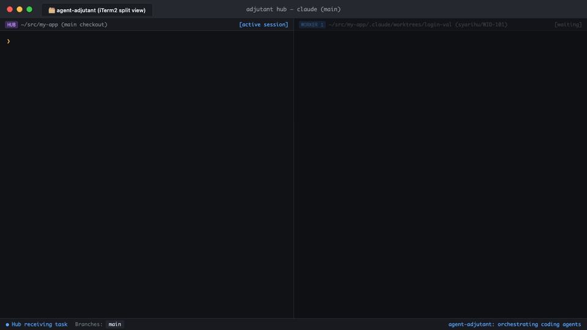

[English](README.md) | 日本語

# agent-adjutant


コーディングエージェントのためのタスク hub を、1つのバイナリで。



`adjutant` はリポジトリの「副官」として、タスクを worker に割り振り、その報告を受け取ります。hub がタスクを選定して worktree を作成し、指示書を用意して別タブで worker を起動します。worker が作業中に関係のないバグを見つけた場合は、自ら修正や Issue 起票を行わずに hub へ差し戻します。これら一連のワークフローは手順書（プロンプト）としてバイナリに同梱されており、MCP 経由でエージェントへ配信されます。

---

## なぜプロンプトを配信するバイナリなのか

従来、エージェントへの手順書は各エージェントのコマンドディレクトリに Markdown ファイルとして配置していました。しかし、ツールのアップデートに伴いファイルが乖離し、環境ごとに古い手順書が残り続ける問題がありました。MCP 経由でバイナリから配信することで、エージェントは常に単一の最新手順を参照できます。

また、hub 名の解決や設定の読み込み、タブ操作、メッセージの受け渡しといった機械的な処理も、以前は複数の手順書に重複して記載されていました。これらを CLI コマンドとして切り出し、手順書からはそのコマンドを呼び出す構成に整理しています。

---

## インストール

### Homebrew

```bash
brew install syarihu/tap/agent-adjutant # `adjutant` と短縮版 `adj` が入ります。tmux と gh も一緒に入ります
gh auth login
adjutant install-mcp                    # Claude Code に MCP サーバーを登録（user スコープ）
#   Antigravity (agy) なら: adjutant install-mcp --target agy
#   他のクライアント向けの JSON を出すなら: adjutant install-mcp --target json
adj server start                        # ボードを起動（既定は http://127.0.0.1:4577）
cd <repository> && adj hub              # そのリポジトリがボードに表示されます
```

`brew upgrade` のあとは `adj server restart` を実行してください。実行しないと、常駐サーバーは古いバイナリのまま動き続けます。

### Cargo

```bash
cargo install --git https://github.com/syarihu/agent-adjutant # `adjutant` と `adj` の両方が入ります
# またはローカルチェックアウトから:
#   cargo install --path .（`make install` でも可。`make restart` は `adj server` の再起動、`make reinstall` は両方を行います）
```

Cargo でインストールしても tmux（3.1 以上）と `gh` は入りません。パッケージマネージャーなどで自分でインストールし、`gh auth login` を実行してください。

> [!IMPORTANT]
> **登録前にバイナリへ PATH を通してください。** PATH が通っていない状態で `install-mcp` を実行するとビルドディレクトリの絶対パスで登録されるため、`cargo clean` などでバイナリが消えるとサーバーが動かなくなります。

### グローバルフックの設定

adjutant が起動した Claude Code の hub や worker には起動時に自動でフックが渡されます。自分で起動した Claude Code セッションや Codex のセッションも `adjutant agent-sessions` やボードの「いまの仕事」に反映させるには、次のコマンドでフックを登録します。

```bash
adjutant setup claude            # ~/.claude/settings.json にフックを追加
adjutant setup claude --remove   # 追加したフックのみを削除
adjutant setup codex             # ~/.codex/hooks.json にフックを追加
adjutant setup codex --remove    # 追加したフックのみを削除
```

> **短縮名について**: `adj` は `adjutant` のエイリアスです。どちらのバイナリを実行しても同じ動作になります。

---

## クイックスタート

1. **常駐ダッシュボードサーバーを起動する**:
   ```bash
   adj server start
   ```
   統合 Web ボードが `http://127.0.0.1:4577` で立ち上がります。

2. **リポジトリの hub を起動する**:
   リポジトリのメインチェックアウトで次のコマンドを実行します。
   ```bash
   adj hub
   ```
   hub が起動し、タスクの監視や worker への作業割り振りを担当する対話セッションが始まります。

3. **タスクを worker に割り振る**:
   ボードの新規タスク入力欄、または CLI から直接指示します。
   ```bash
   adj work --worktree feature-auth --title "OAuth2 ログインの実装"
   ```
   新しいターミナルタブ（または tmux のバックグラウンドウィンドウ）が開き、専用の worktree で worker が実装を開始します。

4. **ボードで確認待ち（gate）に回答する**:
   worker が実装計画、差分レビュー、動作確認などで人間の判断を必要とすると、**gate** が開きます。Web ボード（`http://127.0.0.1:4577`）上で内容を確認し、回答することで worker は次の工程に進みます。

---

## 基本概念

### Hub と Worker
- **Hub**: メインチェックアウトで動作します。受信箱の監視、タスクの優先度判断、独立した worktree の作成、worker への指示出しを担当します。
- **Worker**: タスク専用の git worktree で動作します。一連のフェーズ（`plan` → `implement` → `self-review` → `verify` → `pr`）に沿って実装を進め、人間の判断が必要な箇所で gate を開きます。

### Gate（判断待ちの仕組み）
エージェントが誰も見ていない端末タブで待たされるのを防ぐため、判断が必要なポイントで構造化された **gate** を作成してターンを終了します。
- 確認すべきポイント（計画書、コード差分、検証結果）
- すでに合意された決定事項
- エージェント自身が迷っている点や判断が必要な選択肢

gate には Web ボードから直接回答できるほか、worker のターミナル上（`adj gate close --terminal`）や CLI からも回答できます。

---

## コマンド・ツールリファレンス

### CLI コマンド（`adj` / `adjutant`）

| コマンド | 説明 |
| --- | --- |
| `adj hub [--tab] [--resume\|--new]` | このリポジトリの hub を起動（`--resume` で前回の会話を再開、`--tab` で別タブ起動） |
| `adj work --worktree … (--title … \| --task <id> \| --resume)` | 新しいタブまたはウィンドウを開き、指定 worktree で worker を起動 |
| `adj worker --worktree … [--resume]` | worktree 内で自身を worker として実行（`work` の内部で使用） |
| `adj server start\|stop\|status\|restart` | 全リポジトリを横断する常駐ボードサーバーの管理 |
| `adj focus [--worktree …]` | hub または worker のターミナルタブを前面に表示 |
| `adj phase [--set …]` | worker の現在の進捗フェーズの確認・更新 |
| `adj gate open\|list\|show\|answer\|close` | 人間への判断待ち（gate）の作成・一覧・回答・クローズ |
| `adj task add\|list\|show\|update\|refresh\|park\|unpark` | タスクレコードの管理、GitHub Issue / PR との状態同期 |
| `adj agent-sessions [--json]` | 各エージェントセッションの稼働状態、ツール実行、トークン使用量を一覧表示 |
| `adj send --subject … --body …` | リポジトリ hub の受信箱へメッセージを送信 |
| `adj tell --worktree … --subject …` | 特定 worker の outbox へメッセージを送信 |
| `adj close --worktree …` | worker のターミナルタブを終了 |
| `adj ide --worktree …` | worktree を設定されたエディタで開く |

### MCP ツールとプロンプト

エージェント環境（`adjutant mcp`）内では、以下のプロンプトとツールが提供されます。

- **プロンプト**: `adj-hub`（hub 実行）、`adj-worker`（タスク着手〜完了）、`adj-report`（作業中のバグ報告）、`adj-review-hub`、`adj-reviewer`。
- **ツール**: `adjutant_config`、`adjutant_hub_status`、`adjutant_send`、`adjutant_pending`、`adjutant_tell`、`adjutant_outbox`、`adjutant_gate_open`、`adjutant_gate_close`、`adjutant_refresh`、`adjutant_skill`、`adjutant_work`、`adjutant_gate_read`、`adjutant_reviews`、`adjutant_request`、`adjutant_gate_answer`。

---

## 設定

設定ファイルは `~/.config/adjutant/config.json` です（`$XDG_CONFIG_HOME` および `$ADJUTANT_CONFIG` に対応）。各項目の詳細は [`config.example.json`](config.example.json) を参照してください。

### 主な設定項目

| キー | 既定値 | 説明 |
| --- | --- | --- |
| `terminal.preset` | なし（macOS は iTerm2） | `"tmux"` を指定すると組み込み tmux バックエンドが有効化されます |
| `agentRunner` | `claude ...` | worker エージェントを起動するコマンドテンプレート |
| `hubRunner` | `claude ...` | リポジトリ hub を起動するコマンドテンプレート |
| `reviewerRunner` | `claude ...` | PR の読み手（AI 下読み）を起動するコマンドテンプレート |
| `notification` | `terminal-notifier` / `osascript` | デスクトップ通知のコマンドテンプレート |
| `maxWorkers` | 制限なし | チェックアウトごとの同時稼働 worker の上限数 |
| `hubAutoResumeHours` | `3` | `adj hub` 実行時に前回の会話を自動再開する有効時間（時間単位） |
| `stuckAfterMinutes` | `120` | worker が同一フェーズにとどまっている場合にカードを赤色表示するまでの分数 |
| `language` | なし | gate やメモ、要約にエージェントが使用する言語（例: `"ja"`） |

tmux との連携やカスタムランナーテンプレート、環境変数の解決順序については、[設定とランタイム詳細](docs/configuration.ja.md) を参照してください。

---

## 権限（自動実行モード）

MCP 経由で配信される手順書ではツールの個別許可リストを指定できません。そのため、**hub も worker も既定では自動実行モード（`--permission-mode auto`）で起動します**。これにより、ビルドやバックグラウンド確認がダイアログで停止するのを防ぎます。

実装計画の承認や Issue 起票、差分レビューなどの重要ポイントは、手順書内の gate や `AskUserQuestion` によって安全に確認されます。日常的なコマンドに対しても確認を要求したい場合は、`--permission-mode auto` を外したランナーを設定し、`~/.claude/settings.json` で必要なツールを事前許可してください。

---

## ドキュメント一覧

詳細な機能ガイドは [`docs/`](docs/) 配下に用意されています。

- [**Web ボードと常駐サーバー**](docs/board.ja.md) ([English](docs/board.md)): ボードの各ビュー、「いまの仕事」、「レビュー」（AI 下読み、PR レビュー支援）、REST API、launchd による常駐化設定。
- [**Jules へのタスク委譲**](docs/jules.ja.md) ([English](docs/jules.md)): Google Jules へのタスク割り当て、サブエージェントによる設計書作成、レビュー指摘の自動転送。
- [**設定とランタイム詳細**](docs/configuration.ja.md) ([English](docs/configuration.md)): tmux 連携の詳細、wake の仕組み、ランナーテンプレート、セッションのライフサイクル管理。
- [**アーキテクチャとレイヤ構成**](docs/architecture.md): クレートの内部モジュール構成、レイヤ規則、状態保存の仕組み。
- [**レビューチェックリスト**](docs/review-checklist.md): セルフレビューおよび自動コードレビューで確認すべき観点一覧。

---

## 開発

```bash
cargo test                    # 単体テストおよび結合テストの実行
./scripts/check-layering.sh   # レイヤ境界規則の検証
cargo fmt --check && cargo clippy --all-targets -- -D warnings
```

---

## ライセンス

MIT — 詳細は [LICENSE](LICENSE) を参照してください。
ボードの内蔵ターミナルには xterm.js およびそのアドオン（MIT）が含まれています。ライセンス表記は `src/ui/vendor/xterm/` にあります。
