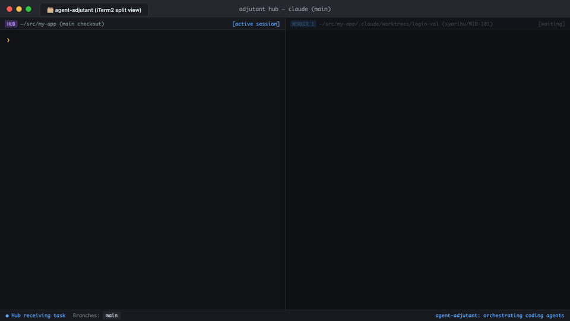

English | [日本語](README.ja.md)

# agent-adjutant


A task hub for coding agents, as one binary.



`adjutant` is a repository's 副官 — its adjutant: it hands work out to workers and takes their reports back in. The hub picks a task, cuts a worktree, writes a brief and starts a worker in a new tab; a worker that trips over an unrelated bug hands it back rather than fixing it or filing it itself. Both halves of that workflow are procedures, and the procedures ship inside the binary served over MCP.

---

## Why a binary that serves prompts

The procedures used to be markdown files copied into each agent's commands directory. A copy drifts: upgrade the tool and the copies stay behind, one per config directory, all subtly different. Served over MCP they are a pointer instead — one upgrade moves every caller.

The mechanical parts (deriving the hub's name, resolving the config, opening a tab, moving a message) used to be prose repeated across procedure files. They are now fast native CLI commands, and the procedures call them.

---

## Installation

### Homebrew

```bash
brew install syarihu/tap/agent-adjutant # installs both `adjutant` and the short `adj`
adjutant install-mcp                   # registers MCP server with Claude Code (user scope)
adjutant install-mcp --target agy       # registers MCP server with Antigravity (agy)
adjutant install-mcp --target json      # prints JSON configuration for other clients
```

### Cargo

```bash
cargo install --git https://github.com/syarihu/agent-adjutant # installs both `adjutant` and `adj`
# or from a local checkout:
#   cargo install --path . (or `make install`; `make restart` restarts `adj server`; `make reinstall` does both)
```

> [!IMPORTANT]
> **Install before registering.** `install-mcp` records the command as `adjutant` if it is already found on your `PATH`. Running `install-mcp` from a target build directory pins that build path, which breaks if `cargo clean` is run.

### Global Hooks Setup

Claude Code hubs and workers launched by adjutant receive hooks automatically. To allow sessions you start manually, or any Codex session, to report to `adjutant agent-sessions` and the board's 「いまの仕事」, register the global hooks:

```bash
adjutant setup claude            # adds hooks to ~/.claude/settings.json
adjutant setup claude --remove   # removes only adjutant hooks
adjutant setup codex             # adds hooks to ~/.codex/hooks.json
adjutant setup codex --remove    # removes only adjutant hooks
```

> **Note on short name**: `adj` is a short alias for `adjutant`. Both binaries are identical.

---

## Quick Start

1. **Start the resident dashboard server**:
   ```bash
   adj server start
   ```
   Serves the unified web board at `http://127.0.0.1:4577`.

2. **Start the repository hub**:
   In your repository's main checkout:
   ```bash
   adj hub
   ```
   The hub runs an interactive agent session responsible for orchestrating tasks and dispatching workers.

3. **Dispatch a task to a worker**:
   From the board's new-task form, or directly via CLI:
   ```bash
   adj work --worktree feature-auth --title "Implement OAuth2 login"
   ```
   A new tab or detached tmux window opens with an isolated worker operating in its own worktree.

4. **Review and answer gates on the board**:
   When the worker needs approval for its implementation plan, diff review, or manual testing, it opens a **gate**. Review and answer the gate directly on the board (`http://127.0.0.1:4577`) to let the worker proceed.

---

## Core Concepts

### Hub & Workers
- **Hub**: Runs in the repository's main checkout. It monitors the inbox, prioritizes tasks, creates isolated worktrees, and delegates tasks to workers.
- **Worker**: Runs in a dedicated git worktree. It executes the task through defined phases (`plan` → `implement` → `self-review` → `verify` → `pr`), opening gates for human decisions when needed.

### Gates (Human-in-the-Loop Decision Points)
Instead of blocking in an unwatched terminal tab, agents create structured **gates** and suspend their turn. Gates display:
- What needs review (plan, code diff, or verification results).
- What has already been decided.
- Where the agent's confidence ran out or where choices need human judgment.

You can answer gates on the web board, in the worker's terminal (`adj gate close --terminal`), or via CLI.

---

## Command & Tool Reference

### Shell CLI (`adj` / `adjutant`)

| Command | Description |
| --- | --- |
| `adj hub [--tab] [--resume\|--new]` | Start the hub for this repository (`--resume` restores previous session, `--tab` opens in a new tab) |
| `adj work --worktree … (--title … \| --task <id> \| --resume)` | Spawn a new tab/window and launch a worker in that worktree |
| `adj worker --worktree … [--resume]` | Run the worker process inside a worktree (called internally by `work`) |
| `adj server start\|stop\|status\|restart` | Manage the resident multi-repository dashboard server |
| `adj focus [--worktree …]` | Raise the terminal tab for the hub or a worker |
| `adj phase [--set …]` | View or update the worker's current progress phase |
| `adj gate open\|list\|show\|answer\|close` | Manage structured human review gates |
| `adj task add\|list\|show\|update\|refresh\|park\|unpark` | Manage task records and synchronize state with GitHub Issues/PRs |
| `adj agent-sessions [--json]` | Inspect active agent states, tools, and token context from the session ledger |
| `adj send --subject … --body …` | Send a message to the repository hub's inbox |
| `adj tell --worktree … --subject …` | Send a message to a specific worker's outbox |
| `adj close --worktree …` | Close the terminal tab for a worker |
| `adj ide --worktree …` | Open the worktree in your configured IDE |

### MCP Tools & Prompts

When running inside an agent session (`adjutant mcp`), adjutant exposes tools and prompts:

- **Prompts**: `adj-hub` (hub orchestration), `adj-worker` (task execution), `adj-report` (bug reporting to hub), `adj-review-hub`, `adj-reviewer`, `adj-aide`.
- **Tools**: `adjutant_config`, `adjutant_hub_status`, `adjutant_send`, `adjutant_pending`, `adjutant_tell`, `adjutant_outbox`, `adjutant_gate_open`, `adjutant_gate_close`, `adjutant_refresh`, `adjutant_skill`, `adjutant_work`, `adjutant_gate_read`, `adjutant_reviews`, `adjutant_show`, `adjutant_request`, `adjutant_gate_answer`.

---

## Configuration

Configuration lives at `~/.config/adjutant/config.json` (`$XDG_CONFIG_HOME` and `ADJUTANT_CONFIG` supported). See [`config.example.json`](config.example.json) for the full commented schema.

### Key Settings

| Key | Default | Description |
| --- | --- | --- |
| `terminal.preset` | none (iTerm2 on macOS) | Set to `"tmux"` to enable the built-in tmux backend |
| `agentRunner` | `claude ...` | Command template used to start worker agents |
| `hubRunner` | `claude ...` | Command template used to start repository hubs |
| `reviewerRunner` | `claude ...` | Command template used to start sandboxed PR readers (AI 下読み) |
| `notification` | `terminal-notifier` / `osascript` | Command template for desktop notifications |
| `maxWorkers` | no limit | Maximum concurrent workers allowed per checkout |
| `hubAutoResumeHours` | `3` | Hours within which `adj hub` automatically resumes the previous conversation |
| `stuckAfterMinutes` | `120` | Flags task cards red if a worker stays in one phase without progress |
| `language` | none | Output language for gates, notes, and task summaries (e.g. `"ja"`) |

For tmux integration, custom runner templates, and environment resolution, see [Configuration & Runtime Reference](docs/configuration.md).

---

## Permissions (Unattended Mode)

MCP-served procedures cannot declare tool allowlists. Therefore, **both hub and worker start unattended by default** (`--permission-mode auto`) so builds and background checks run smoothly.

Crucial checkpoints (approving implementation plans, filing issues, reviewing diffs) remain guarded by the procedures' own gates and `AskUserQuestion` calls. To require confirmation on everyday CLI commands, configure runners without `--permission-mode auto` and allow common tools in `~/.claude/settings.json`.

---

## Documentation

Comprehensive guides are available in the [`docs/`](docs/) directory:

- [**Web Board & Resident Server**](docs/board.md) ([日本語](docs/board.ja.md)): Board views, 「いまの仕事」, AI 下読み (PR review), 副官 (Aide), REST API, and launchd setup.
- [**Jules Integration**](docs/jules.md) ([日本語](docs/jules.ja.md)): Delegating tasks to Google Jules, automated design planning, and review comment relay.
- [**Configuration & Runtime**](docs/configuration.md) ([日本語](docs/configuration.ja.md)): Deep dive into tmux presets, wake hooks, runner templates, and session lifecycles.
- [**Architecture & Layering**](docs/architecture.md): Internal crate modules, architectural rules, and state storage design.
- [**Review Checklist**](docs/review-checklist.md): Checklist used for self-review and automated code reviews.

---

## Development

```bash
cargo test                    # Unit and integration tests
./scripts/check-layering.sh   # Verify architectural boundary rules
cargo fmt --check && cargo clippy --all-targets -- -D warnings
```

---

## License

MIT — see [LICENSE](LICENSE).
The board terminal bundles xterm.js and addons (MIT); notice in `src/ui/vendor/xterm/`.
