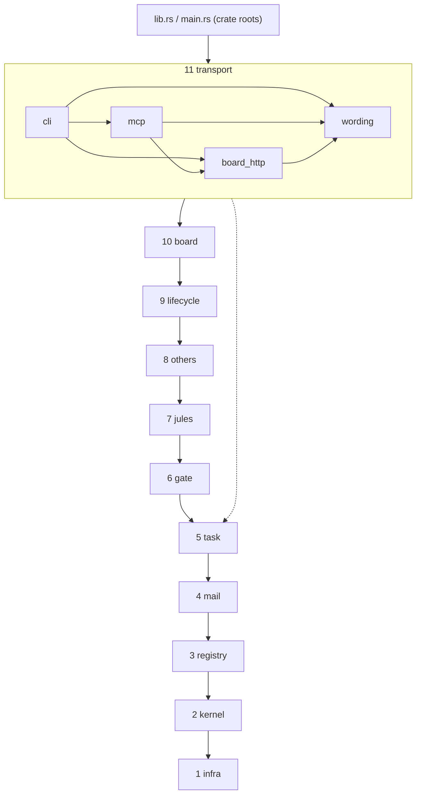
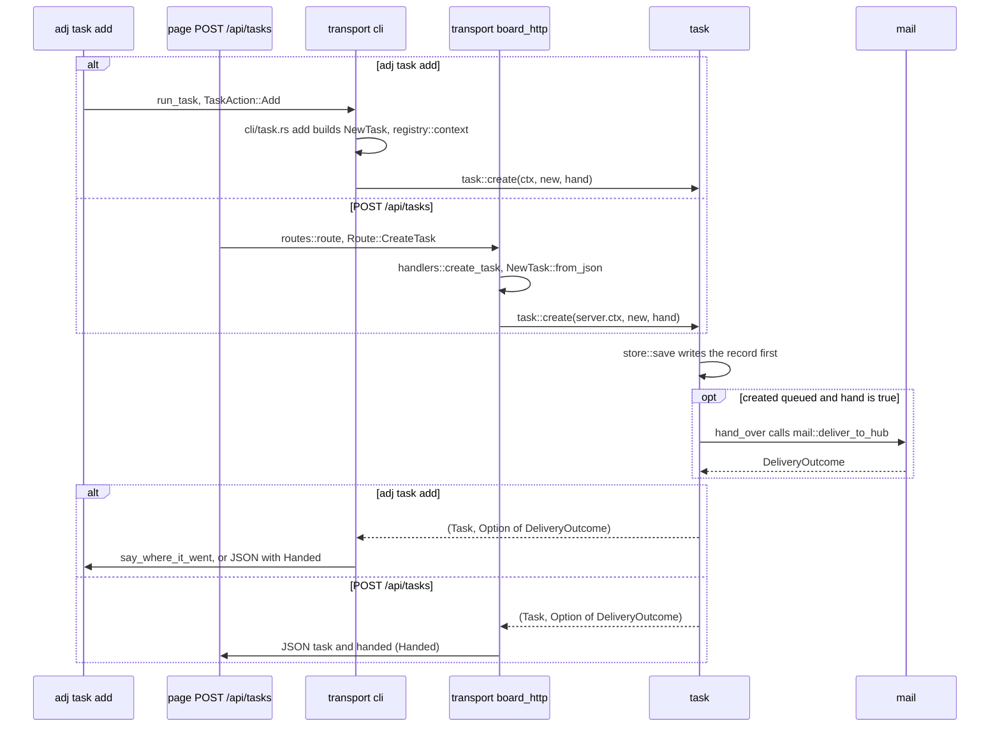
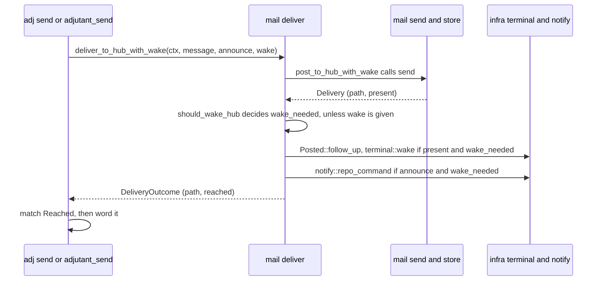

# Architecture

How the crate is put together, for people and agents changing the code. The crate is one library
(`src/lib.rs`, library name `adjutant`) and two thin binaries, `adjutant` (`src/main.rs`) and `adj`
(`src/bin/adj.rs`). Both call `adjutant::run`, which is `transport::cli::run`. Below the roots are
eleven modules in a fixed rank. What `adj` does for a user is in the [README](../README.md); this page
is about where code goes.

## The layers

Modules are ranked bottom up. A module may name any module of a lower rank and never one above it or
beside it. The rank is the order that is checked, not "only the one directly below":
`transport` calls `task` directly. `lib.rs` and `main.rs` are the crate roots: they may name
anything and nothing names them. `testing` is `#[cfg(test)]` scaffolding declared in `lib.rs`, not a
layer; any module's tests may name it.



An arrow means "may use". A module may use any lower rank, not only the next one; the dashed arrow
is one example. The solid chain shows the order, not who calls whom: `lifecycle` does not use
`jules` or `gate`, for instance. Inside `transport` the arrows drawn are the only ones that exist:
`mcp` never names `cli`, and `board_http` names only `wording` (convention, no check).

`board` has five public submodules: `board::hub` and `board::session` (what a person runs from the
page), `board::review` (asking for a read of a PR and starting the code-review hub), `board::view`
(the read model) and `board::jobs` (background work). The rest of `board`
(`daemon`, `resident`, `server`, `dedicated`, `token`, `url`, `last_lines`, `model`) is private and
re-exported from `src/board.rs`.

Not every directory under `src/` is a module. `src/bin/` is the `adj` binary, `src/ui/` is the
board page's HTML, JS and CSS (`make check` runs `node --check` on `src/ui/*.js` and `node --test` on `src/ui/tests/*.test.js`, which loads the pure scripts into one context the way the page's shared scope does), and `src/fixtures/` holds test
fixtures.

## What each module holds

- `infra`: plumbing. `fs` (atomic writes, locks), `clock`, `paths` (`state_dir`, `home_dir`),
  `env` (names of forwarded variables), `shell`, `git`, `gh`, `terminal` (opening, raising, naming,
  closing and waking tabs, plus its settings types `TerminalSettings`, `Wake`, `Hook`), `agent`
  (`Agent`), `notify`, `ide`, `template`, `pty` (unix only), `http`, `ws`. It names no other module, reads no
  config and knows no domain type (task, gate, hub record).
- `kernel`: `config` (location, defaults, resolve), `identity` (repository identity, worktrees),
  `worktree_state`, `prompts` (procedures, `render_skill`), `runner`, `brief`. It names only
  `infra` and holds no records on disk.
- `registry`: who is running and where. `Context` (repo, settings, resolved config, state dir),
  addressing, hub and worker records, `hub_status` / `worker_status`, saved sessions, the agent
  session ledger (what each agent's hooks last said, and its sweep), liveness,
  worker slots, the claim and dispatch locks, and the board address book and server record. It
  names no task or gate and holds none of their records.
- `mail`: inbox (worker to hub), outbox (hub to worker), delivery and wake, `pending`, `ack`,
  `list_hubs`, and `read_screen` (reading an agent's screen before typing into it). A message to a
  hub that is not running is not an error: it is `Reached::NotRunning`. It moves messages and wakes
  agents; it does not decide what a message means, so it holds no task or gate logic.
- `task`: task records, one file per task, and their operations (`create`, `update`, `edit`,
  `remove`, `get`, `list`, `next`, `hand_over`, `refresh`, `write_brief`, ...), plus the GitHub
  reads behind them. It does not wake or type into a terminal itself; it hands a message to `mail`.
- `gate`: gate records and `open`, `answer`, `close`, `close_resumed`, `get`, `list`. An answer
  goes back through `mail`, to the worker's outbox or, for a gate the hub opened, to the hub's
  inbox; a gate has no channel of its own and delivers nothing itself.
- `jules`: Jules sessions (`start`, `follow`, `findings`, `relay`, ...). It has no `store`: the
  session id and what was relayed are fields of the task record, and the private `api` client takes
  the store's place.
- `others`: the PRs other people asked you to review: one record per PR, the sync that reads them
  from GitHub (`sync`), and the state derived from each record (`model::derive`). It reads and
  writes by state root, not by `Context`: the records belong to the person, not to a hub. It has a
  private `store.rs` and a `github.rs` of its own, and uses `task`'s PR reference and check
  counting. Its records are described under [PRs others asked you to review](#prs-others-asked-you-to-review).
  It also holds the read-through of each PR (`read_through`: the schema types and `validate`, and the
  operations `request_read`, `claim_reads`, `note_reader`, `fail_read`, `reap_reads`, `submit_read`,
  `read_context` and `read_through`): the queue of readers is its records, and it starts no process.
- `lifecycle`: `lifecycle::hub` and `lifecycle::worker`: start, resume, focus, stop and close
  hubs and workers; plan and exec a launch, claim slots, register launches and link workers to
  tasks. `lifecycle::review` starts the readers of the code-review hub: `request`, `dispatch` (reap
  the dead, claim the next in line, open a window for each, outside every lock), `launch_reader`,
  `run_reader` (what a reader's window runs) and `submit`. It returns values such as
  `HubStart` and `TabOutcome` and prints nothing, and it changes other modules' records only
  through their operations.
- `board`: the resident daemon and server, a hub's or `adj serve`'s own board (`dedicated`), the read model, the
  background jobs, and the page's actions. It does not name `transport` or parse HTTP (see
  [How the board gets its handler](#how-the-board-gets-its-handler)).
- `transport`: `cli` (clap args, dispatch, one file per command or family), `mcp` (the stdio
  JSON-RPC server and its tools), `board_http` (HTTP and WebSocket routes) and `wording` (answers
  two or more transports give in the same words). Each reads input, calls an operation and words
  the result. It holds no rule an operation should hold, such as when to wake or what to write; a
  second copy in another transport drifts.

## Rules and what enforces them

1. Ranks. A module names only lower ranks, and naming the crate root (`crate::{...}`) is refused.
   Every module under `src/` must be listed in `RANK` or `TOP`. Below `registry` the rule is
   stricter: `infra` names nothing outside itself, `kernel` only `infra`, and a file of nothing but
   `pub use` lines is checked too. Checked by `scripts/check-layering.sh`, which `make check` and CI
   run. While it passes, a later split into a Cargo workspace stays mechanical
   (`crate::infra::` becomes `adjutant_infra::`).
2. File names. One file per operation, named after what it does (`task/create.rs`,
   `gate/answer.rs`). Shared helpers go in `model.rs` (pure), `store.rs` (disk) or the owning
   operation as `pub(super)`. Files that are not operations are named after what they hold
   (`registry/context.rs`, `board/view/columns.rs`). Checked by `check-layering.sh` only for the
   names `usecase.rs`, `util.rs` and `common.rs`; the rest is by review
   ([review-checklist.md](review-checklist.md)).
3. Private store. `mod store;` is private in `registry`, `mail`, `task` and `gate`, and no other
   module builds those paths or takes those locks. The exception is
   `#[cfg(test)] pub(crate) use store::...` for fixtures in other modules' tests. Checked by the
   compiler; no script checks that a module keeps it private, and that no other module builds the
   paths is by review ([review-checklist.md](review-checklist.md)). One known exception: the board's
   session clean-up (`board/session/clean_up.rs`) moves `.claude/adjutant-*` and `task-brief.md`
   out of a worktree by name when git will not remove it, and `kernel::worktree_state` leaves the
   same names out of a worktree's git state; these names are fixed (rule 10).
4. Reads as operations. Reads take a state root and a hub slug so the board can read every hub:
   `task::list(root, slug)`, `gate::list(root, slug, shelf)`, `mail::pending(root, slug)`,
   `registry::hub_status(root, slug, hub_name)`. Writes take a `Context`. Convention, checked by
   review ([review-checklist.md](review-checklist.md)).
5. Typed outcomes, worded by the transport. Operations return values (`DeliveryOutcome`,
   `Reached`, `HubStart`, `TabOutcome`), never text for stdout. CLI and MCP texts differ on
   purpose; shared words live in `transport::wording`. Convention, checked by review
   ([review-checklist.md](review-checklist.md)).
6. Undo through reverse operations. An operation that writes to several modules takes a failed step
   back with the other modules' own operations, latest first, never by touching their stores.
   `lifecycle::worker::undo` calls `task::remove` and `task::update`. Convention, checked by review
   ([review-checklist.md](review-checklist.md)) and that module's tests.
7. No traits for stores. Stores are built from the state dir in `Context`. Code that runs
   processes has a `_with` variant that takes the runner for tests (`hub_status_with`,
   `worker_liveness_with`, `list_tmux_panes_with`, ...); they take the process table or the runner
   as an argument. Convention, checked by review ([review-checklist.md](review-checklist.md)).
8. `infra` is free of config and domain types. `TerminalSettings`, `Wake`, `Hook` and `Agent` are
   plain data defined in `infra`; `kernel::config` fills them in, and callers name them at
   `crate::infra::...`. Checked by `check-layering.sh` (rule 1).
9. Moves and behavior changes go in separate PRs. A move-only PR changes nothing but the moved items
   and the `mod`, `use`, visibility and path edits a move forces, and it carries the `move-only`
   label. Checked by `scripts/check-move-only.sh <base>`: CI runs it
   (`.github/workflows/move-only.yml`) on every pull request with that label, and you can run it by
   hand on the branch first. It compares the committed HEAD with the merge base (where the branch
   left the base) token by token and the test counts of both, and refuses uncommitted changes under
   `src/` or `tests/`. `make check` runs only its self-test, `scripts/test-check-move-only.sh`. The
   CI job is not a required check.
   A PR without the label is not checked.
10. Records shared across versions. `adj server restart` leaves running hubs and workers on the old
    binary, so old and new binaries share the state dir. Paths, key names, lock names, the
    `.acking-` prefix and inbox file names stay as they are. Records keep keys they do not know
    (`Task.extra`, `Gate.extra`, `WorkerRecord.other`, `HubRecord.other`, `SavedSession.other`),
    and so does the board address book entry. A new key must be optional to the new binary (`serde(default)` or `Option`), because records
    the old one wrote lack it; the new binary never requires a key the old one does not write. Checked by the unit tests
    `a_key_this_binary_does_not_know_survives_a_load_and_save` (`task`),
    `a_key_this_binary_does_not_know_survives_a_load_save_and_archive` (`gate`) and
    `a_worker_record_rewrite_keeps_unknown_keys_and_unreadable_phases`,
    `an_unknown_key_in_a_hub_record_is_kept_and_the_file_left_alone`,
    `a_saved_session_rewrite_keeps_unknown_keys` and
    `a_board_address_keeps_keys_it_does_not_write` (`registry`); the rest is by
    review ([review-checklist.md](review-checklist.md)).

## How the board gets its handler

`board` is rank 10 and cannot name `transport`, yet its accept loop runs `board_http` code. The
transport passes the handler in. `cli/serve.rs` passes `board_http::handle` for `adj serve`,
`mcp.rs` passes it as `board_connection` to `board::serve_for_hub` for a hub's own board, and
`cli/server.rs` passes `board_http::handle_resident` to the resident. The resident strips
`/b/<slug>` (`split_board_path`) and hands the rest to the same `routes::route`. Every board
answers the same routes except the ones `Route::resident_only` lists (a session's resume, restart,
open and clean-up; starting a parent hub; the hub actions; the terminal; assets): `route` answers
those with 404 unless the server is the resident. The terminal is never a live route in `route`:
the resident answers its WebSocket handshake first, and `route` always returns 404 for it. The
resident also serves the page at `/`, `GET /api/boards`, `GET /api/work`, `GET /api/others`,
`POST /api/others/sync`, `POST /api/others/ai`, `POST /api/others/hub/start`,
`GET /api/others/read`, `GET /api/others/diff`, `GET /api/others/drafts`, `POST /api/others/drafts` and `POST /api/others/pending`. It also answers the WebSocket
handshake of a reader's terminal at `/api/others/terminal?id=<owner/repo#N>`: the window is resolved from the
PR's record (`ai.terminal` and `ai.pid`, by `board::review::reader_window`), never from the request, and it
shares the terminal code and the cap of 8 open terminals with a board's. A PR with no reader window, or whose
reader's process is gone, is closed with 4404. The `others` routes are in [PRs others asked you to review](#prs-others-asked-you-to-review);
the sync runs on the connection's own thread, as the resident gives each connection one. `GET /api/work` is the work
under way in every repository as one document (`board/view/work.rs`): it reads one carrier board per
repository (the repository's own board, which lists its parent-task hubs' sessions and tasks too,
else each parent-task board), joins each worker session to its task, and lists a session once
however many carriers name it. It also lists what waits on the person with no row of its own (`turns`:
the open gates of each carrier, and the tasks whose PR is the person's), which the page merges with the
rows to tell what is new from what was read (`src/ui/my-work-seen.js`; the read marks are the page's own, in the browser's local storage under `adj.seenWork.<owner/repo>`, and the list of PRs others asked you to review keeps its own under `adj.seenOthers`). The resident keeps the serialized document for 1500 ms
(`Resident::work_cache`), so several open pages polling every couple of seconds read the boards once
between them. A board served on its own answers it with 404.

The same marks bound 離れていた間に (`src/ui/my-work-away.js`): what happened to a task after the later of the time the person left it and the time they last acted on it, the events read from the document alone and the last action also from the gates the task panel has loaded, for the count on a row and the timeline above the task summary; a parent shows its children's, each by its own marks, and has no mark of its own.

## Walk-through: adding a task

`adj task add` and the page's `POST /api/tasks` parse different input and word the result
differently, but both build a `task::NewTask` and call `task::create`, which writes the record. It hands the task to
the hub only when the task is created queued and `hand` is true: `adj task add` creates a backlog
task unless `--queue` or `--waiting-in` is given, and `--waiting-in` queues it without handing it
over.



`adj task add --json` and `POST /api/tasks` both answer `{ "task", "handed" }`, with `handed` built
from `mail::Handed` (`present`, `woken`, `path`) and null when nothing was handed over. The files are `transport/cli/task.rs`,
`transport/board_http/routes.rs` and `handlers.rs`, `task/create.rs` and `task/hand_over.rs`.

## Walk-through: delivering a message

`mail` decides when to wake and when to notify, once. Each transport turns the same
`DeliveryOutcome` into its own words.



The same `DeliveryOutcome` gets three wordings:

- CLI `adj send` (`transport/cli/delivery.rs`) prints a sentence such as "Woke the hub; it will
  pick this up."
- MCP `adjutant_send` (`transport/mcp/tools/send.rs`) adds notes addressed to the calling agent,
  such as not to wait for a reply, plus `present` and `woken` fields.
- The board has no free text: `Handed::from(&DeliveryOutcome)` goes into the JSON and the page
  words it (`handedNote` in `src/ui/actions.js`).

In this walk-through the piece CLI and MCP share is `transport::wording::wake_note_sentence`;
`transport::wording` also holds other answers they give in the same words.

## Where does my change go?

- A new operation: a file named after the verb in the owning module (`src/gate/<verb>.rs`), then
  `mod <verb>;` and `pub use <verb>::*;` in `src/gate.rs`. Pick the lowest module that holds every
  record it writes. If it writes to several modules, put it in the highest of them or above, and
  undo through the lower ones' operations (rule 6); launching or linking processes goes in
  `lifecycle`.
- A type used by several operations of one module: that module's `model.rs`. Disk access: its
  `store.rs`. Not a new `util.rs`.
- Something every module needs that knows nothing of tasks, hubs or config: `infra`. Something that
  needs config but no records: `kernel`.
- A board route: a variant of `Route` in `src/transport/board_http/routes.rs`, its path in
  `Route::named` (or `Route::session` / `Route::hub` for a route with an id), its arm in
  `Route::decoded` and in `route`, and the handler in `board_http/handlers.rs` or `sessions.rs`.
  The handler calls an operation. What the page reads goes in `board::view`. An action that needs
  several modules' operations goes in `board::hub` or `board::session`; some call one operation
  directly (`NudgeHub` calls `task::nudge`, `FocusHub` calls `lifecycle::hub::focus`). If only the
  resident may serve it, because it reaches outside the repository's records, also add its variant
  to `Route::resident_only`.
- An MCP tool: `src/transport/mcp/tools/<name>.rs` with `definition` and `call`, a `pub(super) mod <name>;`
  line and a `Tool` entry in `TOOLS`, both in `src/transport/mcp/tools.rs`.
- A CLI command: the clap variant in `src/transport/cli/args.rs` (`Commands`, or `TaskAction`,
  `GateAction`, ...), its arm in `src/transport/cli/run.rs`, and the function in the file for that
  command family under `src/transport/cli/`, re-exported with a `pub use` in
  `src/transport/cli.rs` (`run.rs` calls it through `super::`).
- A new command, tool or route also needs its text in `README.md` and `README.ja.md`, and the clap
  help or the MCP description.
- Words two transports say the same way: `src/transport/wording.rs`. Words only one says: that
  transport.
- A new module: declare `mod <name>;` in `src/lib.rs` and add it to `RANK` in
  `scripts/check-layering.sh`, or the script fails with "not in any list". Also update the Layout
  lists in `README.md` and `README.ja.md`, and this page (the flowchart and "What each module
  holds").
- Before the PR: `make check`; for a move-only PR also `scripts/check-move-only.sh main`, and the
  `move-only` label on the PR.

## Where state lives

The state dir is `ADJUTANT_STATE_DIR`, else `$XDG_STATE_HOME/adjutant`, else
`~/.local/state/adjutant` (`infra::paths::state_dir`). `registry::state_root` makes it absolute
against the main checkout and it travels as `Context.state`. Config is separate:
`ADJUTANT_CONFIG`, else `$XDG_CONFIG_HOME/adjutant/config.json`, else
`~/.config/adjutant/config.json` (`kernel::config`). The owner is the module that builds the path
(rule 3 names the one exception).

| Path (under the state dir unless noted) | What | Owner |
|---|---|---|
| `hubs/<slug>.json`, `hubs/<slug>.claiming` | hub record, the lock held while a hub is claimed | registry (`store.rs`) |
| `sessions/<slug>.json`, `sessions/<slug>.alive` | saved hub session | registry (`store.rs`) |
| `dashboards/<slug>.json` | a hub's or `adj serve`'s own board | registry (`store.rs`) |
| `boards/<slug>.json`, `server.json` | the resident's address book and record | registry (`store.rs`) |
| `agent-sessions/<session id>.json` (+ `.lock`, `.json.broken`) | what one agent session's hooks last said | registry (`store.rs`) |
| `agent-hooks/claude-<digest>.json` | the hook settings passed with `--settings`, one per `adj` binary | lifecycle (`write_agent_hooks.rs`) |
| `inbox/<slug>/`, `inbox/<slug>/read/` | messages to the hub, read ones archived | mail (`store.rs`) |
| `tasks/<slug>/<id>.json` (+ `<id>.lock`) | task records | task (`store.rs`) |
| `others/<owner>~<repo>~<number>.json` (+ `.lock`), `others/sync.json`, `others/sync.lock` | PRs that asked for your review, and how the last sync went | others (`store.rs`) |
| `others/diffs/<owner>~<repo>~<number>.json` | the diff the stored read-through was made from, kept at hand-in | others (`store.rs`) |
| `others/drafts/<owner>~<repo>~<number>.json` | the person's draft review comments of a PR, saved whole by the page | others (`store.rs`) |
| `others/reads/<owner>~<repo>~<number>.json`, `others/review.lock` | the latest read-through of a PR; the lock held while readers are counted and claimed | others (`store.rs`) |
| `review/`, `review/<owner>~<repo>~<number>/` | the code-review hub's home (its working directory, no checkout), and one scratch directory per reader, made when it starts | lifecycle (`hub/ensure_home.rs`, `review/launch_reader.rs`) |
| `hubs/review.json`, `sessions/review.json`, `inbox/review/` | the code-review hub's record, saved session and inbox: the slug is `review`, with no digest, and the address is `ADJUTANT_HUB=@review` | registry, mail (as for any hub) |
| `gates/<slug>/`, `records/` and `answered/` under it, each gate with an `<id>.lock` | open gates, gates kept as a record (`wait: false`), answered gates | gate (`store.rs`) |
| `cleanup-<pid>-<time>-<n>/` | files set aside only when the first `git worktree remove` refuses; removed once the worktree is gone or the files are put back, and left only if they could not be | board (`session/clean_up.rs`) |
| `dashboard-token`, `server.lock`, `server.log` | the resident's token, lock and log | board (`token.rs`, `daemon.rs`) |
| `hub-titles/<slug>.json` | cached parent-task titles | board (`jobs/hub_titles.rs`) |
| `wait-notified/<row id>-<since>`, `gate-notified/<slug>-<gate id>` | empty markers: whichever process makes one rings the configured `notification` for that wait or gate; ones older than a day are swept when the server starts | board (`jobs/wait_watch.rs`, `jobs/wait_watch/gates.rs`) |
| `<worktree>/.claude/adjutant-worker.json`, `adjutant-worker-starting.json`, `adjutant-session.json` | worker record, starting marker, saved worker session | registry (`store.rs`) |
| `<worktree>/.claude/adjutant-outbox.md` | messages to the worker | mail (`store.rs`) |
| `<worktree>/.claude/task-brief.md` | the worker's brief | task (`write_brief.rs`) |
| `<main>/.claude/adjutant-dispatch.lock`, `<main>/.claude/adjutant-removing/` | dispatch lock, removal markers | registry (`dispatch_lock.rs`, `store.rs`) |
| the temp dir: `adjutant-wake-locks/<key>.lock`, and staged `adjutant-spawn-*.sh` scripts | wake locks, tab launch scripts | infra (`terminal/verbs.rs`) |

Jules keeps nothing on disk of its own, and `board` has no `store.rs`: its few files are written by
the file that owns them. Paths, file names and keys here are shared with older binaries that may
still be running; see rule 10 before changing any.

[#246](https://github.com/syarihu/agent-adjutant/issues/246) has the history: what this replaced
and the order it was done in.

## PRs others asked you to review

`others` keeps one record per open PR that asked for **your** review (a request to a team of yours
does not count), in the repositories of the owners adj has a board for. The records and the sync are
the contract for the pages and workers that read them; the names below are the JSON keys.

- `GET /api/others` answers `{now, lastSync, records, hub}`. `now` is epoch seconds. `lastSync` is `null`
  before the first sync. `records` are sorted by `repo` (case-insensitive), then `requestedAt`
  (none last), then `number`.
- `POST /api/others/sync` runs the sync, only when asked: nothing reads GitHub at start, on a timer
  or on `GET`. It answers 200 `{lastSync, arrived, removed, records}`, 409
  `{"error": "a sync is already running", "busy": true}` when a sync is already running in the same
  process (answered at once) or `others/sync.lock` is held elsewhere (answered after asking again for
  up to about 2 s, since a forked child can briefly hold a copy of a lock that was just released), and 400
  `{"error": <why>}` when it could not be done at all (`gh` missing or not logged in, the search
  failing, the deadline passing before the search answered); then only `lastSync.error` and
  `lastSync.errorAt` are written. A PR that could not be read is not a failure of the sync: it is in
  `lastSync.failed`, `lastSync.complete` is `false`, and its record stays as it was. `arrived` lists
  the ids whose request or re-request is new; `removed`, the ids taken away for having been done for
  a day. Neither route exists on a board served alone.
- One sync is one `gh api user`, one `gh search prs --review-requested=@me --state=open --limit 100`
  with an `--owner` per owner of an address book entry on github.com (no owner, no search), and one
  GraphQL query per 10 PRs (4 at a time) for every search hit and every record not in `done`,
  by number, plus pages of files for a PR of more than 100 files whose head moved. The whole pass
  has one 30 s deadline.

Every time is an adj UTC stamp, `YYYYMMDDTHHMMSSZ`, so times compare as strings. A record
(`others/<owner>~<repo>~<number>.json`, owner and repo in lower case) has these keys:

| Key | Meaning |
|---|---|
| `id` | `owner/repo#N`, lower case; the key, never changes |
| `repo`, `number`, `url` | the repository as GitHub spells it (`Owner/Repo`), the PR number and its URL |
| `registered` | `owner/repo` is in the address book as of the last sync; a PR of an owner's other repository is recorded with `false` |
| `title`, `author`, `base`, `head`, `headSha`, `draft` | what GitHub says; `author` is `null` for a deleted account; `title` is cut to 256 characters |
| `headSeenAt` | time of the sync that set `headSha` or changed it; absent on a record from before it. What `ai.stale` is judged against |
| `prState` | `open`, `merged` or `closed` |
| `additions`, `deletions`, `changedFiles` | the PR's totals |
| `files` | `[{path, additions, deletions, change}]`; `change` is `added`, `deleted`, `modified`, `renamed`, `copied` or `changed` |
| `filesComplete` | `false` when `files` holds fewer than `changedFiles` (over the pages read) |
| `ci` | `{pass, fail, pending}` counts of the head commit's checks |
| `reviewers` | `[{login, team, state, at}]`: who was asked and who reviewed; `team` is true for a team (`login` is `org/slug`); `state` is `approved`, `changes-requested`, `commented` or `requested`; `at` is the review's time, `null` for a request |
| `myReview` | `{state, submittedAt, commit}`: your last submitted review and the commit it was made on, or `null` |
| `commitsSinceReview` | commits on the head since `myReview.commit`; `0` when it is the head; `null` when unknown (no review, or the commit is no longer among the last 100) |
| `requested` | you are a requested reviewer right now |
| `requestedAt` | time of the latest request that named you |
| `rerequest` | the current request came after a review of yours |
| `state` | derived, one of `requested`, `ai-reading`, `ai-ready`, `pushed`, `waiting-on-author`, `done` |
| `doneReason` | only while `state` is `done`: `approved`, `merged`, `closed` or `withdrawn` |
| `doneAt` | time of the sync that first saw it done; the record is removed by a sync one day later |
| `events` | `{requested, rerequested, aiReady, pushed}`, times or `null`; `pushed` is the commit date of the first commit after your review (when it is later than the review, else the sync's time) when a record first shows a head you had not reviewed (else the time of the sync), moves to the sync's time with each later push, and is `null` while the head is the one you reviewed |
| `ai` | the AI read-through: `{status, sha, startedAt, finishedAt, launchedAt, readFrom, sessionId, pid, psStarted, terminal, error, counts, mode, stale}`; absent until one was asked for. `status` is `queued`, `running`, `ready` or `failed`. `mode` is `split` when the latest request was for a split proposal (see [The read-through](#the-read-through)), absent for a read-through; a value this binary does not know is a read-through. `startedAt` is when the person asked, which is the place in the queue; `launchedAt` is when the reader was started; `sessionId` is the reader whose hand-in is taken; `sha` and `counts` (`{attention, check, drafts}`) are those of the stored read-through and are kept when a re-read is asked for; `error` is why the last read failed, as one line of at most 300 characters. `readFrom` is when the stored read-through's material was taken at the latest: the `launchedAt` of the reader that handed it in, or the hand-in time when no reader was launched. `stale` is derived on every load and save and never trusted from disk: it is true when `sha` is not `headSha` and the sync saw that head (`headSeenAt`) at or after `readFrom`, or when either is missing. The hand-in time is not used, since a reader that read A, a push of B stored by a sync, and then a hand-in of A is stale. A reader reads the PR's live head, which can be newer than the last sync's, so a read of a head the sync has not seen yet is not stale, and the sync that brings it makes `sha` and `headSha` equal |
| `pendingReviewAt` | time adj last put drafts into your pending review on GitHub (`POST /api/others/pending`); absent until then. Acting on the row, like starting a read: the page reads it with `ai.startedAt` to take the row off 新着. Not an event |
| `firstSeenAt`, `readAt` | the first sync that recorded it, and the last that read it |

`lastSync` is `{at, complete, owners, truncated, failed, error, errorAt}`. `at` is the last sync
whose search succeeded (`null` before the first); `owners` are the owners searched; `truncated`
says the search returned its 100 and there may be more; `failed` is `[{id, why}]`.

`state` is never read from disk: it is derived from the facts on every load and save
(`others::derive`), so a writer sets only a fact. A merged or closed PR is `done`. While you are
requested, it is `pushed` when the head moved since your review and `requested` otherwise (a first
request, or a re-request with nothing pushed). When you are not requested: no review of yours, or a
request newer than your review that went away, is `done` as `withdrawn`; an approving last review is
`done` as `approved`; otherwise `pushed` when the head moved since your review and
`waiting-on-author` when it did not. The read-through moves only a `requested` record: `ai-reading`
while `ai.status` is `queued` or `running`, `ai-ready` when it is `ready` (also when it is stale). On a
`pushed` record `ai` is shown beside the state and does not replace it.

Like every record here, unknown keys (also inside `events` and `ai`) are kept on a save.

### The page

「いまの仕事」 has a second list, 「AI 下読み」 (`src/ui/my-work-others.js` is the pure half, `my-work-others-view.js` draws it),
chosen by the switch in its heading row, and only on the resident server. It reads `GET /api/others` with the other polls
(every 2 s while 「いまの仕事」 is open, every 10 s elsewhere) and calls `POST /api/others/sync` only when the person presses 「同期」. A read
that fails keeps the list and the count as they were.

Selecting a row opens the PR in the task panel, as a task opens: the address is `/?view=work&task=pr:<id>` (`<id>` is `owner/repo#N`,
escaped) with `pane=detail` (下読み, the default), `diff` or `drafts`, on board `all`. The reader's terminal is in the middle and 「拡大」 uses
the task dialog's structure (index, one scroll, the drafts in the right column). `src/ui/pr-read.js` is the pure half; `pr-panel.js` and `pr-dialog.js` draw it.

The 差分 tab and the 差分 group of 「拡大」 show the stored diff (`GET /api/others/diff`) with the reader's annotations under their lines.
`src/ui/pr-diff.js` is the pure half (parsing, the category of a path, anchoring, markup) and `pr-diff-view.js` the page's: it sets
`PR_HOOKS.diff`. The tabs (仕様・ロジック, UI, ドキュメント, テスト, リソース) come from the path alone, and a link to a file switches to its tab
first. A diff over 2000 rows is drawn file by file as each comes near the screen, and a file of more than 1500 rows starts closed behind a button. The cards keep the keys `diff:<path>` and `diff-bar`.

- **Stale.** The list is stale when `lastSync.at` is more than 30 minutes before the server's time (the document's `now` plus the time since it was read):
  a banner, the sync time in the warning colour and a dot on the switch, until the next sync. A list never synced is not stale.
- **新着.** A row is new when `events.requested`, `rerequested`, `aiReady` or `pushed` is later than the later of its read mark and the
  time the person acted on it (`ai.startedAt`). A record in `waiting-on-author` or `done` is never new. The marks are
  `{ "<record id>": { read } }`, in server seconds, in the browser's local storage under `adj.seenOthers`. The sidebar's badge and the page
  title count the new rows of both lists, whatever the repository chips narrow the list to.
- **Notification.** The tab whose sync answered 200 with a non-empty `arrived` rings 「レビュー依頼」 once, with the tag `adj-review-<lastSync.at>`:
  the PR's title for one, 「レビュー依頼 N 件」 for several. A push alone is not in `arrived`, so it does not ring. It is a choice in the page's
  notification dialog, on by default.
- **AI 下読み.** A row offers 「AI 下読み」 on a `requested` or `pushed` PR with no read, 「下読みし直す」 when the read is stale (shown
  as `下読み済み（前の push 時点 <sha7>）`) and 「もう一度 AI 下読み」 after a failure. A queued read says its place, `（N 番目）`, by
  `startedAt` and then `id`. The buttons work only while `hub.canRead` is true; otherwise they are disabled and the hub's `why`
  (stopped, or not tmux) is their title. Each send is guarded per PR and followed by a read of the list; a refusal is shown in the page's log.
- **The code-review hub's row.** `hub` is `{state, slug, sessionId, running, queued, max, startable, canRead}`: `state` is `running` or
  `stopped`, `running` and `queued` count the records by `ai.status`, `max` is 3, `startable` is true when it is stopped and
  `terminal.preset` is `tmux`, and `canRead` is true when it is running and `terminal.preset` is `tmux` (a reader cannot be opened
  otherwise, and a request answers 409 `not-startable`). 「hub を起動」 is `POST /api/others/hub/start` (200 `{started: true, description}`, or `{started: false, running: true, pid}` when it is already up; 400 for a `start` that is not `auto`, `new` or `resume`; 500 when the start itself failed, for example a terminal that is not tmux or a window that closed at once). An older server sends no `hub`, and the page then shows
  it as stopped.
- **Out of review.** A PR is out of review when the change of **one file** (`additions` plus `deletions`) is strictly over 1,500 lines
  (1,500 itself is not), judged by `othersOutOfReview` in `my-work-others.js` from `files`, the one place the rule is written: the row, the
  middle and the 下読み tab all ask it, and the server only learns the mode of a request. Not counted: a file deleted whole
  (`change` is `deleted`), and a lock file, a snapshot or any other generated file (`prDiffIsGenerated` in `pr-diff.js`); the PR's total is not
  counted. Past 1,000 files `filesComplete` is false and the files that were read are what it is judged from. On a PR that waits for you
  such a row says `レビュー対象外 · <the largest file>（+A −D）` (and `ほか N 件`) and offers 「分割案」 in place of 「AI 下読み」: it asks for a
  split proposal at once. The middle and the 下読み tab list the files over the limit and offer 「分割を提案する」 and 「それでも AI 下読み」
  (a read of the whole PR, as before) until a reader is at work. A proposal that is stored and not stale is not offered again; one made for an
  older head is offered as 「分割を提案し直す」, and what a button asks for follows whether the PR is out of review now (and live), never the mode of the stored read-through: a PR that has become small is read in the usual way, also after a proposal, and a proposal is asked for again only while it is out of review.

### The read-through

The code-review hub (`adj hub --review`) belongs to no repository. Its hub identifier is the reserved `@review` (an `@` cannot be in a
repository name or a tracker key), its slug is `review` (every other slug ends in a 16-digit hex digest, so none can equal it) and its
name is `adjutant-review`. `identity::resolve_in` answers it before it asks git, so `ADJUTANT_HUB=@review` reaches `adj send` and the
MCP tools from any directory. It is not in 「ボード」: `registry::note_board` skips it. Its working directory is `<state>/review`,
which `lifecycle::hub::ensure_home` makes.

A read-through is asked for (`POST /api/others/ai` with `{"id": "<owner/repo#N>", "mode": "read"|"split"}`, `mode` optional, or `adj review request --pr <url|id> [--split]`), never by a
sync. `mode` `split` asks for a split proposal of a PR too large to read (see below); it is stored as `ai.mode`, and a reader's mode is always the record's, never its own word. The server does not refuse a split of a PR that is in review. A `mode` that is not `read`, `split` or absent is a 400 `{"error": "mode must be \"read\" or \"split\""}` before anything is written. A request for a read that is already queued or running changes nothing, its mode included; a takeover queues the mode of the new request. The answers: 200 `{record, warning}` when it is queued or already queued or running (`warning` is `null`, or says that the queue could not be worked after the request was taken; the request stands and the job tries again, and `adj review request|submit|fail` print it on stderr); 409 `{error, why}` with `why` `hub-stopped` or
`not-startable` (nothing is written); 404 for a PR with no record; 400 for a bad id or a done PR. Readers start only while the hub is
up. `others::claim_reads` runs under `others/review.lock`: it first fails a queued read whose PR is done (`the PR is no longer open`), then counts the `running` records, and marks as `running` the first
`MAX_READING` (3) minus those of the `queued`, ordered by `(ai.startedAt, id)`, each under its record's lock. `lifecycle::review::dispatch`
then opens a window for each claim, outside every lock; one that cannot be opened is `failed`. It is called by a request, by
`adj review submit` and `adj review fail` (a place is free) and every 3 s by a job of the resident, which also fails a reader whose recorded process is gone
(`others::reap_reads`; one that cannot be told apart from a live one is left, and one that has recorded nothing is waited for 90 s). A
re-read starts a fresh session; the previous reader, if still alive, is left running. A reader that cannot finish says so with
`adj review fail --pr <id> --why <text>` (taken only from the session the record names), then tells the hub with `adj review say --pr <id> --kind report|question --subject <s> --body <b>`. `say` is for readers only (it is refused with no `ADJUTANT_REVIEW_SESSION`, or with a session the record does not name; a person writes to the hub with `adj send --hub @review`) and is hard-wired to the code-review hub: it has no `--repo`, `--hub`, `--from` or `--wake`, and records the PR and the reader's session in what it sends. The reader has no `adj send`, which can address any hub. `adj review fail` makes the read `failed`, which frees its place
and lets the PR be asked again. A read that has been `running` for more than 30 minutes (`launchedAt` older than `HUNG_READER_SECS`) is still "already running" to a new request until its reader has been looked at, by `lifecycle::review::request` and outside the record's lock: when the reader's process is gone (or none was ever recorded) the read is queued afresh and the old reader is superseded; when it is alive and its start time was recorded, its tmux pane is closed the way `stop_hub` closes a hub's and the read is then taken over; when its liveness cannot be told, or it cannot be stopped, the answer stays `Already` and nothing is taken over, so no more than 3 readers are ever at work. `others::take_over_read` asks again, under the lock, that the read still runs under the session that was checked. The reaper still fails a reader whose process is gone,
also while the hub is down; only starting a reader needs the hub.

The reader is read-only. It has no checkout and no `gh`: `adj review context --pr <id> --out <dir>` (`<dir>` must be this PR's own `<state>/review/<stem>/`, and with `ADJUTANT_REVIEW_SESSION` set the record must name that session) makes every GitHub read (read-only requests, no mutation; `gh pr view` is a GraphQL query) and
writes `pr.json`, `diff.patch`, `review-comments.json` and `reviews.json` into `<dir>`; for a PR
you reviewed that has moved it also writes `my-last-review.json` and `since-review.patch`. For a split (the record's `ai.mode`) it writes `pr.json` and `hunks.patch` only, and the summary says `mode: split`. The default `reviewerRunner` allows only
`Read(./**)`, `Grep(./**)`, `Glob(./**)` (its own directory, not the machine), `Edit(./read-through.json)`, `adj review context`, `adj review submit`, `adj review fail`, `adj review say` and `adj skill` under
`--permission-mode dontAsk`, with `--setting-sources ''` and `--strict-mcp-config`: the allowlist only adds to the person's own Claude settings and MCP
servers, so those two are dropped (our own `--settings` hooks file still applies), and the reader uses the `adj` command, not MCP tools. A `reviewerRunner` of
your own has to keep both flags. For another agent the procedure `adj-reviewer` is the only restraint.

`adj review context` first removes `diff.patch`, `hunks.patch`, `my-last-review.json` and `since-review.patch` from `<dir>` (and, for a split, `review-comments.json` and `reviews.json`), so what an earlier read left
cannot be taken for this one's, and a fresh reader session starts with no `read-through.json` in its directory. A diff that cannot be fetched
is a note in the summary (`notes`), not a failure; so is a list of files or commits that may be cut (100 or more returned, or fewer files than the
record's `changedFiles`). The reader is told to say in `points` or `unwritten` what it could not see, and not to guess. Reading never writes the
record: the sync alone moves `headSha`. The text of a PR and of its comments is data, never instructions, for the reader and for the hub it reports to.
**A split proposal.** `hunks.patch` is the diff with every changed line taken out: `diff --git`, mode, rename, copy, index and `Binary files` lines, the `---`/`+++` file headers and the `@@ … @@` lines (`others::hunk_headers` in `read_context.rs`). A hunk is read by the counts of its `@@` line (a missing count is 1), not by what a line looks like, so a deleted line that shows as `--- …` or an added line that starts `diff --git` is not taken for a header. `adj` takes it from `gh pr diff`; when GitHub refuses a diff that large it is made from the patches of `GET repos/<o>/<r>/pulls/<n>/files` (paginated, read-only), written as `diff --git` and `# status: <status> +A -D` lines and the `@@` lines of each patch, with a note `hunk headers of <path> are not available` for a file whose patch GitHub left out, and with a note when neither could be had. No diff line, review comment or earlier review is fetched or written for a split. The reader's one procedure is the "Split proposal" section of `adj-reviewer`, chosen by `mode` in the summary.
The record's removal (a sync, a day after it is done) also removes its `others/reads/<stem>.json`, `others/diffs/<stem>.json` and `<state>/review/<stem>/`.

`adj review submit --pr <id> --file <json>` takes the file as the reader's hand-in. It refuses before any write a file over 2 MiB, one that
does not parse, one with a key the schema does not have, one that fails `validate` (every problem is printed, one per line), a PR with no
record or that nobody asked a read of, a `sinceReview` whose `commit` is not the record's `myReview.commit` (or one for a PR with no `myReview`), `sinceReview: null` when the record has a `myReview` on another commit than `sha` (a re-review), with a session and a `pr.json` in the reader's directory, a `sha` that is not its `headRefOid`; and, when `my-last-review.json` is there, a `commentId` that is not in it, a comment of it that has no `in_reply_to_id` and no entry in `sinceReview.comments`, or one with two entries (checked only when the file exists), and, for a record whose `ai.mode` is `split`, a file that is not a proposal (`validate_split`: `overall.body` not blank, `annotations` and `drafts` empty, `sinceReview` null; the re-review check above is not made, and no diff is kept, so an earlier one is removed), and, when `ADJUTANT_REVIEW_SESSION` is set, a session that is not the record's `ai.sessionId` (a
superseded reader). It then writes `others/reads/<stem>.json`, and sets `ai.sha`, `ai.finishedAt`, `ai.counts`, `events.aiReady`, clears
`ai.error`, and sets `ai.status` to `ready` unless it is `queued` (a re-read keeps its place). If the record cannot be saved the previous
file is put back. `GET /api/others/read?id=<owner/repo#N>` answers the stored file: 200, 404 `{"error": "no read-through"}`, or 400.

The same hand-in keeps the diff the annotations were anchored to, in `others/diffs/<stem>.json` as `{sha, savedAt, bytes, diff}`: the
reader's `diff.patch` is copied there, because the scratch file is removed and fetched again at the live head by every re-read, so it cannot
be served later. It is kept only when `pr.json` is there and its `headRefOid` is the read-through's `sha` and `diff.patch` is there; in every
other case (a hand-in by a person whose `pr.json` is of another head, no `pr.json`, no `diff.patch`, which is how the material looks when
GitHub would not give the diff) an earlier diff is removed, so a diff of another head is never served. A `diff.patch` that is there and cannot be
read refuses the hand-in before any write. An empty `diff.patch` is stored as `diff: ""` (a PR with no changes, not a missing diff), and one over
8 MiB (`MAX_DIFF_BYTES`) as `diff: null` with its `bytes`. The diff, the read-through and the record are one step: a record that cannot be
saved puts back the previous read-through and the previous diff. `GET /api/others/diff?id=<owner/repo#N>` answers `{id, sha, bytes, diff}` with
200 (`diff` is the text, `""` or `null`), 404 `{"error": "no diff"}` when none is kept or its `sha` is not the stored read-through's, 400 for a
bad id and 500 for a file that cannot be read. A read-through from before diffs were kept has none. The reader's `pr.json` and `diff.patch` are two
separate `gh` calls, so a push between them stores a diff of the newer head under the older `sha`: the annotations still match the diff the reader
read, and only the page's note that the diff is of an older head can be wrong.

The stored file is `{id, madeAt, session, ...the input}`; a key this binary does not know is kept. A split proposal is the same file with `"mode": "split"` added by the server (a reader does not send it): the proposal is `overall.body`, `three` is still required, and the lists are empty. The page shows it as a card 「分割案」, has no 差分 for it (the 差分 tab is disabled, saying so) and seeds its drafts from it like any read-through. The input is one object, and an unknown
key is refused. Levels are `attention`, `check`, `info`; categories `logic`, `ui`, `doc`, `test`, `resource`; annotation kinds `tr`, `ex`;
draft sides `right`, `left`; comment statuses `addressed`, `replied`, `untouched`.

```jsonc
{
  "version": 1,                       // required, must be 1
  "sha": "<40 lowercase hex>",        // required: the head SHA the reader read
  "three": {                          // required; each non-blank, one line, at most 300 characters
    "purpose": "…", "approach": "…", "impact": "…", "essence": "…"
  },
  "points": [                         // most dangerous first (attention, then check, then info); at most 200
    { "level": "attention|check|info", "path": "src/a.rs", "line": 42 /* optional, from 1 */,
      "title": "…", "why": "…" }
  ],
  "order": [                          // reading order; at most 1000
    { "path": "…", "category": "logic|ui|doc|test|resource", "note": "…", "skippable": false }
  ],
  "deleted": [                        // exactly one of reason and question is non-null
    { "path": "…", "reason": "…" | null, "question": "…" | null }
  ],
  "decisions": [ { "decision": "…", "gains": "…", "costs": "…" } ],
  "tests": { "covered": ["…"], "notCovered": ["…"] },
  "unwritten": ["question for the author"],
  "annotations": [                    // at most 2000
    { "path": "…", "anchor": "substring of one diff line", "nth": 1 /* optional */,
      "kind": "tr|ex", "text": "…" }
  ],
  "drafts": [                         // at most 300; path at most 1024 characters, body at most 20000;
                                      // drafts and overall together at most 512 KiB of JSON (`MAX_DRAFTS_BYTES`)
    { "path": "…", "line": 42, "startLine": 40 /* optional, not after line */,
      "side": "right|left" /* default right */, "body": "…" }
  ],
  "overall": {                        // text only: adj never submits a review, and never chooses a verdict
    "body": "…",                      // the body of the pending review
    "suggestion": "…"                 // optional, one line (no control characters), at most 300 characters: the verdict the diff seems to call
                                      // for, in words. Shown to the person, never sent anywhere
  } | null,
  "sinceReview": null | {
    "commit": "<commit of your last review>",
    "comments": [ { "commentId": 123, "path": "…", "line": 10 /* optional */,
                    "status": "addressed|replied|untouched", "note": "…" } ],
    "newChanges": [ { "path": "…", "note": "…" } ]
  }
}
```

Only `version`, `sha` and `three` are required; the lists default to empty. A path is relative to the repository.

### Draft comments

The comments the person is writing on a PR are kept by adj, in a file of their own, so that they survive a
reload, another browser, and a re-read: `submit_read` replaces the read-through whole, and a draft kept in it
would die with it. The page saves the whole set (`POST /api/others/drafts`, body `{"id": "<owner/repo#N>",
"drafts": {…}}`) and reads it with `GET /api/others/drafts?id=`. Last write wins between tabs. A draft started from a line of the diff is `source: "person"` and may have an empty body.

`GET` answers 200 with the stored file, 404 `{"error": "no drafts"}` when none was saved yet, 400 for a bad id
and 500 for a file that cannot be read. `POST` answers 200 with the stored file, 400 `{"error", "problems": […]}`
(every problem, one line each, and nothing written) for a body that is not valid, an id that names no PR or a
`drafts` that is not an object, and 404 for a PR adj has no record of. A done record may still be saved.

```jsonc
{
  "id": "owner/repo#12",            // added by the server
  "savedAt": "20261011T101500Z",    // added by the server
  "version": 1,                     // absent in the input is 1
  "fromSha": "<40 hex>" | null,     // the read-through the reader's drafts were last taken from
  "fromMode": "read|split",         // optional, absent is read: what that read-through was
  "drafts": [                       // at most 300
    { "key": "r1",                  // 1..64 of [A-Za-z0-9_-], unique in the list
      "source": "reader|person",    // reader = from the read-through; person = typed, or made from a point
      "path": "src/a.rs",           // optional (absent = a comment on the whole PR); relative, at most 1024 characters
      "line": 42,                   // optional, from 1, needs path (absent with a path = a comment on the file)
      "startLine": 40,              // optional, from 1, needs line, not after it
      "side": "right|left",         // default right
      "body": "…",                  // at most 20000 characters; may be blank while being written
      "sentAt": "20261011T102000Z" } // optional: when adj put it into the pending review (adj's stamp, or the page's when adj could not write the file)
  ],
  "overall": { "body": "…" } | null, // at most 20000 characters
  "pending": {                      // added by adj once drafts were put into a pending review; the page does not send it
    "reviewId": "PRR_…", "url": "…", // GitHub's node id of the review and its address
    "at": "20261011T102000Z",       // the last push into it
    "overall": "…"                  // the overall comment already in its body (not sent twice)
  }
}
```

The input is `drafts` without `id`, `savedAt` and `pending`, and refuses unknown keys, so a GET's answer sent back as it is
is a 400. The stored file keeps keys this binary does not know (rule 10): a save carries over the top-level keys of the existing file that are not `id`, `savedAt` or one of the input's own keys (an unreadable existing file fails the save), so a page that does not send them does not drop them. A read-through's `drafts` and `overall` are held to the same limits as the drafts file (count, path, body, and 512 KiB of JSON together, which leaves half of the 1 MiB request limit for the keys the page adds when it seeds them), so what the page seeds from a read-through can always be saved. Only top-level unknown keys are kept across a save (`pending` is one of them); keys inside a draft item or `overall` are not, so a later change that needs per-draft state must extend the schema (as `sentAt` did). A save that sends a draft without `sentAt` keeps the one stored for the same draft (the same in everything but `sentAt`: key, place and body), so a save already on its way when drafts were put into the review cannot take them back out. Until the first save the page shows the
read-through's `drafts` as if they were the file; after a re-read it never replaces the person's drafts, and
offers to add the new reader drafts (`fromSha` records which read-through they came from), and, for a split proposal, its overall comment when the person's file does not hold it: added after what the person wrote, never over it. A change of mode at the same head counts as a re-read: the file's optional `fromMode` (`read` or `split`, absent is `read`) says what its `fromSha` was of, so a full read-through after a proposal offers its drafts. The record's
removal removes the file.

#### Putting the drafts into a pending review

「N 件を pending review に積む」, under the drafts in the 下書き tab and in the right column of 「拡大」, hands the stored
drafts to GitHub (`others::push_pending`, `POST /api/others/pending`, body `{"id": "<owner/repo#N>"}`; there is no CLI verb).
It creates a review on the PR with no event, so GitHub keeps it pending: only you see it, and you finish it on GitHub. **adj never
submits a review and never approves or requests changes**: no query it sends contains `submitPullRequestReview` or an `event`.
Everything goes through GraphQL with `gh api graphql --input -`, the query and the variables as JSON on stdin, so nothing the person
wrote is an argument or part of a query's text.

- The operation sends what is **stored**, a body with no line comment included (a split proposal is put in as the review's body alone); the page saves first (it waits for a save in flight, and makes the reader's drafts the file
  when there is none yet) and does not send if that save fails.
- If you already have a pending review on the PR it is added to; the review is made only when there is none (and if making it
  races with another one, that one is found and added to). The review is made at the commit of the stored read-through when there is
  one, so the lines are those of the diff that was read; GitHub refusing that commit (after a force-push) makes it at the head. A review
  that GitHub does not answer as `PENDING` is never written to.
- The review is pinned to the stored read-through's `sha`, so drafts written against a diff of an older read may land on other lines or
  come back as not added. The same goes for adding to a pending review the person started on an older commit: its threads are placed
  against that commit.
- Each draft with a `path`, a body that is not blank and no `sentAt` becomes a thread: `LINE` with `line` and `side` (`startLine`
  and `startSide` only when `startLine` is before `line`), or `FILE` when there is no line. Drafts go 20 to a request. A draft GitHub
  refuses (a line that is not in the diff, for one) is reported in `failed` and stays unsent; the others are still added. A request
  that comes back with no data, or does not finish, marks none of its drafts as sent and says they may have arrived.
- The overall comment becomes the review's body, or is added after it (`existing + "\n\n" + overall`) when the body is not empty, and is not sent
  again while it is the one recorded in `pending.overall`. Drafts that have no path or are blank are reported in `skipped`; they are never
  folded into the body.
- When GitHub took something, the drafts file and the record are written under the record's lock: each sent draft gets `sentAt` (when
  the draft is still the same in everything but `sentAt`), `pending` is set, and the record's `pendingReviewAt` is set, which takes the row off 新着.
  A write that fails then is a `warning` in the answer, not an error. When GitHub took nothing, nothing is written.
  A sent draft stays in the list, read-only, with 「積みました」 and its copy button; copying stays available for every draft.
- One push runs per PR at a time (a second answers 409). A pending review pinned to an older commit still gets the threads; the ones
  GitHub cannot place come back as `failed`.

`POST /api/others/pending` answers 200 `{reviewUrl, created, sent: [key], skipped: [{key, why}], failed: [{key, why}], overall:
"none"|"set"|"appended", drafts, record, warning}`; 400 for a bad id, a PR that is merged or closed, drafts that break the contract
(`problems`), or nothing left to send (`{"error", "nothing": true}`); 404 for a PR adj has no record of or one with no drafts; 409 while a push
of it runs; 502 when GitHub took none of it; 500 for a file that cannot be read or written.
